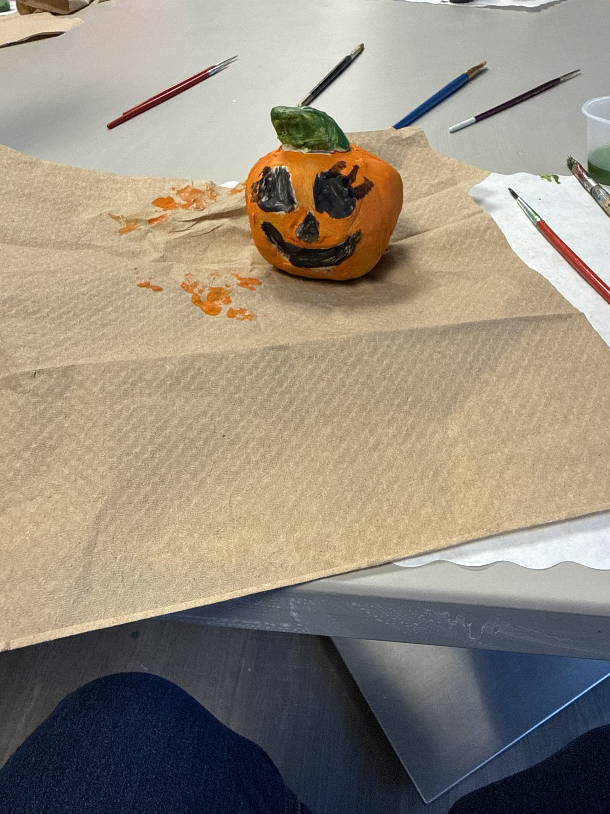

# Fred and The Blue Ribbon Escape

*Written by Evelyn, with assistance from ChatGPT and Claude (AI)*

*Fred and Halloween Town, Part 1. Version 1 of 1: see the [prompt log](prompt-log.md) for how it was made.*

*The real Fred: the painted clay pumpkin by Valerie Mignault that inspired the story.*

Fred was six months old and, according to Farmer Grady, a complete disappointment.

Every morning the farmer stomped through the pumpkin patch carrying a tape measure, muttering about the county fair.

“Bigger! I need bigger!” he would shout at the pumpkins.

The giant pumpkins loved it.

They puffed out their sides and bragged constantly.

“Look at me,” boomed Big Bertha, a pumpkin so large that squirrels used her as a playground. “I’ll win the blue ribbon.”

Fred looked down at himself.

He was round.

He was orange.

He had a cheerful smile painted across his face.

He even had a jaunty green leaf perched on top of his head.

But he wasn’t giant.

Not even close.

One chilly October evening, Fred overheard Farmer Grady talking to himself in the barn.

“That little pumpkin won’t win me anything,” the farmer growled. “Tomorrow I’ll turn him into pie filling.”

Fred nearly dropped his leaf.

Pie filling?

He liked pie.

But he didn’t want to be pie.

That night, under the moonlight, Fred began to rock.

Back.

Forth.

Back.

Forth.

At first nothing happened.

Then—

**ROLL!**

Fred tipped onto his side and began rolling across the field.

“I’m escaping,” he whispered.

Past the cornfield he rolled.

Past the scarecrow.

Past the chickens.

One chicken squawked, “Good luck, Fred!”

By sunrise he had reached the farm road.

Unfortunately, Farmer Grady looked out his window.

His eyes widened.

“FRED!”

The farmer grabbed his axe.

And not just any axe.

It was his old county-fair axe, polished until it gleamed in the morning sun.

Fred had seen that axe before.

It chopped firewood.

It split fence posts.

It once cut a watermelon in half from twenty feet away during a very questionable Fourth of July demonstration.

Fred didn’t wait around to find out which part of him was destined for pie.

He rolled.

Fast.

Well… fast for a pumpkin.

Behind him came Farmer Grady, charging over the hill with the axe swinging over his shoulder.

“FRED!”

Fred rolled faster.

The farmer chased him through the cornfield.

Fred zigzagged between rows.

The farmer swung.

**THWACK!**

The axe buried itself in a scarecrow.

“Sorry, Harold!” shouted Grady as he yanked it free.

Fred rolled downhill.

The farmer followed.

Halfway down, Grady stepped on a pumpkin vine.

His feet flew upward.

The axe sailed through the air and landed blade-first in a hay bale.

Fred couldn’t help laughing.

Farmer Grady was now covered in hay and corn silk.

Still, he kept coming.

“You won’t get away!”

Fred rolled onto a narrow bridge crossing Miller Creek.

The farmer raced after him.

But halfway across, the old boards creaked.

Crack.

Crunch.

The bridge decided it had endured enough nonsense for one lifetime.

**CRAAAACK!**

Part of the bridge collapsed beneath Farmer Grady.

The railing gave way.

The farmer tumbled into the river below.

Fortunately, the river wasn’t very deep.

Unfortunately, he landed in the middle of a fishing tournament.

Seven startled fishermen, twelve duck decoys, and one extremely angry goose immediately surrounded him.

The goose was especially upset.

Farmer Grady spent the rest of the day explaining himself to local authorities, wildlife officials, and the Goose Protection Society.

By the time he returned home, Fred was long gone.

Very long gone.

Because while rolling through the woods, Fred discovered something remarkable.

A crooked sign hanging from a dead tree.

It read:

**HALLOWEEN TOWN**

This Way → 🎃

Fred had never heard of Halloween Town.

It sounded promising.

So he followed the sign.

The deeper he rolled into the forest, the stranger things became.

The moon grew larger.

The fog glowed purple.

Bats flew in neat formations like tiny air traffic controllers.

Eventually he emerged through a gate made entirely of candy corn.

Beyond it stood Halloween Town.

Pumpkins floated through the air.

Skeletons rode bicycles.

Ghosts operated bakeries.

Black cats managed the post office.

Witches sold enchanted caramel apples.

Vampires drank tomato juice from crystal goblets.

And every citizen stopped what they were doing when they saw Fred.

The town fell silent.

A vampire dropped his umbrella.

A witch spilled her pumpkin-spice tea.

A mummy fainted dramatically.

“He’s adorable,” whispered someone.

“No,” said another. “He’s impossibly adorable.”

Within minutes a crowd gathered.

Fred smiled his cheerful painted smile.

The crowd gasped.

Several zombies burst into happy tears.

A werewolf immediately knitted him a tiny cape.

Word spread quickly.

Soon the Mayor of Halloween Town arrived.

The mayor was a twelve-foot-tall scarecrow wearing a tuxedo.

“Young pumpkin,” he announced, “we have never seen such an exceptionally charming citizen.”

Fred blushed.

Which is difficult when you’re already bright orange.

The mayor cleared his throat.

“There is only one appropriate response.”

The crowd leaned forward.

“We shall crown him royalty!”

The town erupted in cheers.

“But I’m not a king,” said Fred.

“Excellent point,” said the mayor.

“Nor am I a queen.”

The mayor thought for a moment.

Then his face lit up.

“Then we shall crown you Princess Fred of Halloween Town!”

The cheering became deafening.

*“PRINCESS FRED!  
PRINCESS FRED!  
PRINCESS FRED!”*

That evening a grand ceremony was held in the town square.

Ghosts hung lanterns made from moonlight.

Skeletons played trumpets.

Witches filled the sky with sparkling orange fireworks.

A sparkling crown made of silver vines and moonlit spider silk was placed atop Fred’s leafy stem.

The Mayor raised his hands.

“I present to you, Her Royal Highness, Princess Fred of Halloween Town!”

The crowd cheered so loudly that bats flew out of nearby bell towers.

From that day forward, Princess Fred became the most beloved resident in all of Halloween Town.

Children adored him.

Ghosts adored him.

Monsters adored him.

Even the notoriously grumpy gargoyles adored him, though they denied it whenever anyone asked.

He judged costume contests.

Led the annual Moonlight Parade.

Settled disputes between haunted scarecrows.

And served as the official greeter of every pumpkin who arrived in town feeling different or out of place.

Every Halloween night, Princess Fred would sit atop the Grand Pumpkin Tower, gazing over the glowing streets below.

The lanterns twinkled.

The ghosts drifted happily through the air.

The music of celebration echoed through the town.

And Fred would smile his familiar smile and think about how lucky he was.

Farmer Grady had wanted the biggest pumpkin.

But Halloween Town had discovered something far more valuable.

Not every pumpkin needs to be the largest.

Sometimes the smallest pumpkin has the biggest heart.

After all, not every little pumpkin escapes a county-fair farmer with an axe, rolls through an enchanted forest, and becomes beloved royalty.

But then again—

not every little pumpkin is Fred. 🎃👑✨
