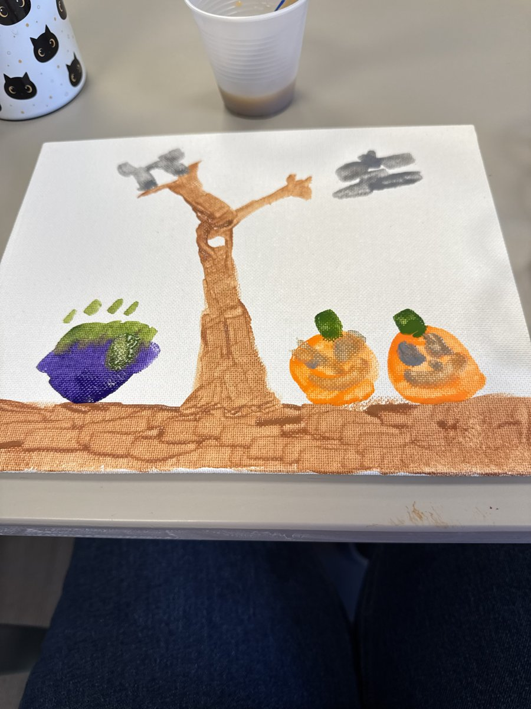

# Fred and the Pumpkin Spice Plot

*Written by Evelyn, with assistance from Claude (AI)*

*Fred and Halloween Town, Part 2. Version 2 of 2: see the [prompt log](prompt-log.md) for how it was made.*

*The painting that inspired the story: the cauldron, the gnarled tree, the bats, Fred and Fluffy.*

Ruling Halloween Town was wonderful.

It was also exhausting.

After judging forty-one costume contests in a single week, Princess Fred announced he was taking a break.

He packed nothing, because pumpkins don't have luggage.

He brought two companions.

The first was Sam, his familiar, a black cat with golden eyes and strong opinions.

The second was Fluffy, his best friend, a pumpkin who was not fluffy in any way. Nobody knew where the name came from. Fluffy refused to discuss it.

They settled beside a gnarled old tree at the edge of the Whispering Woods.

Sam climbed to the highest branch and pretended to nap.

Sam never actually napped. Sam supervised.

Two bats circled overhead. Their names were Pip and Squeak, and they were on patrol, as usual.

"Unidentified cauldron, bearing left," reported Pip.

"Bearing left!" squeaked Squeak, one octave higher.

"It's bubbling," said Pip.

"Bubbling!" squeaked Squeak.

It was.

On the other side of the tree sat a purple cauldron, burping green steam.

Behind it stood Griselda Wartwhistle, the only witch ever banned from the Halloween Town bake sale.

She was brewing an evil pumpkin spice potion.

One sip, and every citizen would obey her forever.

She stirred. She sniffed. She frowned at her recipe.

"Cinnamon. Nutmeg. Cloves. And one whole pumpkin, offered to the evil spirits."

She peeked around the tree.

She saw Fluffy.

"Perfect," she whispered.

Before Fred could blink his painted eyes, Griselda scooped up Fluffy and held him over the cauldron.

"FLUFFY!" cried Fred.

"I KNEW this vacation was a bad idea!" cried Fluffy.

Fred could not climb. Fred could not fly. Fred could not even reach.

But Fred was royalty, and royalty delegates.

"Sam!" he shouted. "Pip! Squeak! By order of the Princess, save that pumpkin!"

"Save that pumpkin!" squeaked Squeak, who couldn't help it.

Pip dove for the witch's hat and yanked it over her eyes.

Squeak snatched the recipe and flew it straight up into the dark.

And Sam leapt.

Sam landed on Griselda's shoulders with every claw she owned.

The witch shrieked. She spun. She swatted with her spoon.

Sam dodged. Sam hissed. Sam boxed her nose eleven times in two seconds.

Griselda stumbled backward.

The gnarled old tree, which had been listening the whole time, lifted one root. Just a little.

She tripped.

Fluffy flew out of her hands, bounced once, and rolled right into the cauldron's leg.

CLANG!

The cauldron wobbled. It tipped. It had never liked Griselda anyway.

SPLOOSH!

Green potion poured over the witch from hat to boots.

She sat in the puddle, blinking.

Without its final ingredient, the potion wasn't evil at all.

It was just pumpkin spice.

Griselda licked her lips.

"Oh," she said. "That's actually quite good."

Fred rolled forward and gave her his sternest look, which was difficult with a permanent smile.

"Griselda Wartwhistle, you tried to sacrifice my best friend."

"I did," she admitted.

"Your punishment," said Fred, "is to serve that drink at every town festival. Free. Forever. With no pumpkins in it."

"Mission accomplished," said Pip.

"Accomplished!" squeaked Squeak.

The tree rustled.

Sam licked one paw, as if nothing had happened.

Fluffy rolled over to Fred, slightly dented and very relieved.

"Next vacation," said Fluffy, "we go to the beach."

Fred smiled his familiar smile.

After all, not every little pumpkin has a cat who fights witches, two bats on patrol, and a best friend named Fluffy.

But then again—

not every little pumpkin is Fred. 🎃🐈‍⬛
